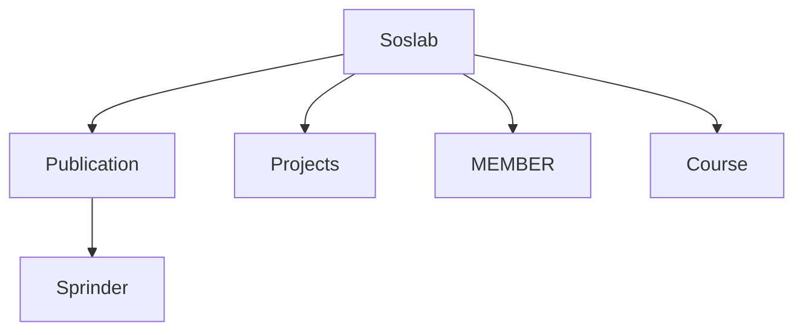
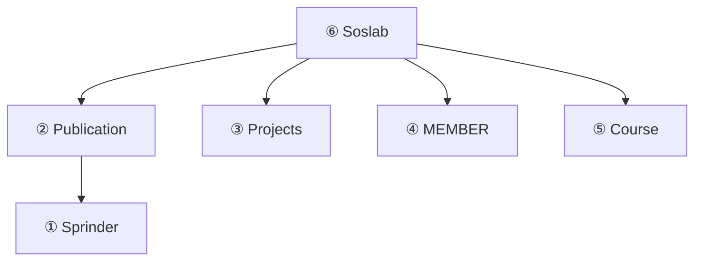

# HW6 Step-by-Step Guidance：計算網站樹的分數

> 這份文件是寫給**會 Python、但沒寫過 Java** 的人。
> 先補 Java 語法（每個都和 Python 對照），再帶你讀懂現有程式碼，最後一步一步把 4 個 `// YOUR TURN` 填完。
> 題目規格請以 [hw6.md](hw6.md) 為準。

---

## 0. 一句話說明這份作業

> **有一棵「網站樹」→ 每個節點是一個網頁 → 依關鍵字算出每頁的分數 → 由下往上把分數加到父節點 → 用括號格式把整棵樹印出來。**

輸入：

```
2 Yu 1.2 Fang 1.8
```

意思是「有 2 個關鍵字：`Yu` 權重 1.2、`Fang` 權重 1.8」。

輸出：

```
(Soslab,633.6
	(Publication,431.4
		(Sprinder,60.0)
	)
	(Projects,54.0)
	(MEMBER,12.0)
	(Course,5.3999999999999995)
)
```

你**只要改 3 個檔案、填 4 個地方**：

| # | 檔案 | 方法 | 要做什麼 |
|---|---|---|---|
| 1 | `WebPage.java` | `setScore` | 算「這一頁自己」的分數 |
| 2 | `WebNode.java` | `setNodeScore` | 自己的分數 + 所有小孩的分數 |
| 3 | `WebTree.java` | `setPostOrderScore` | 用**後序**走訪整棵樹，把每個節點的分數算好 |
| 4 | `WebTree.java` | `eularPrintTree` | 用**前序**走訪整棵樹，照格式印出來 |

其他檔案（`Main.java`、`Keyword.java`、`WordCounter.java`）都已經寫好了，**不用動**。

---

## 1. Java 語法速成（對照 Python）

下面只教**這份作業會用到的**語法，不求完整。

### 1-1 最大的差別：分號、大括號、型別

| | Python | Java |
|---|---|---|
| 一行結束 | 換行就好 | **一定要加 `;`** |
| 程式區塊 | 靠縮排 | 靠 `{ }`（縮排只是好看） |
| 變數 | 直接用 `x = 3` | 要先寫型別：`int x = 3;` |
| 註解 | `# 註解` | `// 註解` 或 `/* 多行註解 */` |
| 空值 | `None` | `null` |
| 布林值 | `True` / `False` | `true` / `false`（小寫） |

```python
# Python
x = 3
if x > 0:
    print("positive")
```

```java
// Java
int x = 3;
if (x > 0) {
    System.out.println("positive");
}
```

注意 Java 的 `if` 條件**一定要用小括號 `( )` 包起來**。

### 1-2 基本型別

| Java 型別 | 意思 | Python 對應 | 例子 |
|---|---|---|---|
| `int` | 整數 | `int` | `int count = 5;` |
| `double` | 小數 | `float` | `double score = 1.2;` |
| `String` | 字串（S 大寫！） | `str` | `String name = "Yu";` |
| `boolean` | 真假 | `bool` | `boolean ok = true;` |

變數宣告一次就好，之後再用就不必寫型別：

```java
double score = 0;   // 宣告 + 給初始值
score = 5.5;        // 之後直接改值，不要再寫 double
score += 2;         // 跟 Python 一樣有 +=，現在 score 是 7.5
```

> ⚠️ 新手常見錯誤：在同一個方法裡寫兩次 `double score = ...;`，Java 會報錯說變數已經定義過了。

### 1-3 印東西：`print` 與 `println`

| Python | Java |
|---|---|
| `print("hi")`（會換行） | `System.out.println("hi");` |
| `print("hi", end="")`（不換行） | `System.out.print("hi");` |
| `print()`（只換行） | `System.out.println();` |

字串可以用 `+` 接其他型別，Java 會**自動把數字轉成字串**（Python 要自己寫 `str()`）：

```java
String name = "Soslab";
double score = 633.6;
System.out.println("(" + name + "," + score);   // 印出 (Soslab,633.6
```

印 `double` 的時候 Java 會自動顯示 `.0`，所以 `60` 會印成 `60.0`，正好就是作業要的格式。

### 1-4 迴圈：for-each

Python 的 `for x in list:`，在 Java 寫成：

```python
# Python
for k in keywords:
    print(k.name)
```

```java
// Java
for (Keyword k : keywords) {
    System.out.println(k.name);
}
```

讀法：「對 `keywords` 裡的**每一個** `Keyword`，叫它 `k`」。
冒號 `:` 左邊要寫**元素的型別 + 變數名稱**。

### 1-5 `ArrayList`：Java 的 list

| Python | Java（`ArrayList<WebNode> children`） |
|---|---|
| `children = []` | `children = new ArrayList<WebNode>();` |
| `children.append(x)` | `children.add(x);` |
| `children[0]` | `children.get(0)` |
| `len(children)` | `children.size()` |
| `len(children) == 0` | `children.isEmpty()` |

`ArrayList<WebNode>` 裡的 `<WebNode>` 是說「這個 list 只能裝 `WebNode`」。Python 的 list 什麼都能裝，Java 則要事先講好。

### 1-6 class 與物件

Java 的 class 跟 Python 很像，只是寫法不同。以作業的 `Keyword` 為例：

```python
# Python
class Keyword:
    def __init__(self, name, weight):
        self.name = name
        self.weight = weight

k = Keyword("Yu", 1.2)
print(k.name)
```

```java
// Java
public class Keyword {
    public String name;      // 欄位要先宣告型別
    public double weight;

    public Keyword(String name, double weight) {   // 建構子 = __init__
        this.name = name;                          // this = self
        this.weight = weight;
    }
}

Keyword k = new Keyword("Yu", 1.2);   // 建立物件要寫 new
System.out.println(k.name);
```

| Python | Java |
|---|---|
| `__init__` | 跟 class **同名**的方法（建構子） |
| `self` | `this` |
| `Keyword("Yu", 1.2)` | `new Keyword("Yu", 1.2)` |

**在方法裡，`this.` 通常可以省略。** 例如在 `WebPage` 的方法裡，寫 `score` 就等於 `this.score`（Python 則一定要寫 `self.`）。

### 1-7 方法（函式）

```python
# Python
def count_keyword(self, keyword):
    ...
    return 3
```

```java
// Java
public int countKeyword(String keyword) {
//     ↑ 回傳型別      ↑ 參數也要寫型別
    ...
    return 3;
}
```

- 回傳型別寫在方法名前面；**`void` 表示不回傳任何東西**（像 Python 沒有 `return` 的函式）。
- `public` 是「外面的 class 也能呼叫」，`private` 是「只有自己這個 class 能呼叫」。寫作業時照原本的寫法就好，不用改。

### 1-8 同名方法（overloading）—— Python 沒有的東西

`WebTree.java` 裡有**兩個**都叫 `setPostOrderScore` 的方法：

```java
public void setPostOrderScore(ArrayList<Keyword> keywords)                       // 版本 A：1 個參數
private void setPostOrderScore(WebNode startNode, ArrayList<Keyword> keywords)  // 版本 B：2 個參數
```

Java 允許同名方法存在，只要**參數不一樣**，呼叫時會依你傳的參數自動選版本。

- `Main` 呼叫 `tree.setPostOrderScore(keywords)` → 跑版本 A
- 版本 A 再呼叫 `setPostOrderScore(root, keywords)` → 跑版本 B

所以**真正要寫的是版本 B**（有 `startNode` 的那個）。`eularPrintTree` 也是同樣的設計。

對應到 Python 的話，大概像這樣：

```python
def set_post_order_score(self, keywords):          # 版本 A：給外面用，從 root 開始
    self._set_post_order_score(self.root, keywords)

def _set_post_order_score(self, start_node, keywords):   # 版本 B：真正的遞迴
    ...
```

### 1-9 `throws IOException` 是什麼？

你會看到很多方法後面寫 `throws IOException`：

```java
public void setScore(ArrayList<Keyword> keywords) throws IOException {
```

意思是「這個方法裡可能發生 I/O 錯誤（例如連不上網路），我不處理，丟給呼叫我的人」。
因為 `countKeyword` 會上網抓網頁，所以有呼叫它的方法都要這樣宣告。**這些都已經幫你寫好了，不用管它。**

### 1-10 遞迴

遞迴跟 Python 完全一樣，就是方法呼叫自己：

```java
private void hello(WebNode node) {
    System.out.println(node.webPage.name);
    for (WebNode child : node.children) {
        hello(child);        // 呼叫自己
    }
}
```

---

## 2. 怎麼編譯與執行 Java

Python 是寫完直接 `python main.py`，Java 則要**兩步**：

1. **編譯**：`javac *.java` → 把 `.java` 翻成 `.class`（電腦看得懂的格式）
2. **執行**：`java Main` → 執行 `Main` 這個 class 的 `main` 方法（**不加 `.java`、不加 `.class`**）

在 VS Code 開啟終端機（`` Ctrl + ` ``），輸入：

```powershell
cd "G:\我的雲端硬碟\六上\Data Structure\ta-github\2026Fall-DS\student\HW6\HW6_110208064"
javac *.java
java Main
```

- 路徑有空白和中文，所以 `cd` 後面**一定要加雙引號**。
- 執行 `java Main` 後程式會停下來等你輸入。打 `2 Yu 1.2 Fang 1.8` 按 Enter，就會印出結果；可以繼續輸入下一行。要結束時按 `Ctrl + Z` 再按 Enter（或直接 `Ctrl + C`）。

**懶得每次手打？用輸入檔：**

1. 在 `HW6_110208064` 資料夾裡新增 `input.txt`，內容寫：
   ```
   2 Yu 1.2 Fang 1.8
   ```
2. 執行：
   ```powershell
   cmd /c "java Main < input.txt"
   ```
   `<` 的意思是「把 `input.txt` 的內容當成鍵盤輸入」。

> ⚠️ 不要用 `echo "2 Yu 1.2 Fang 1.8" | java Main`。在 Windows PowerShell 5.1 裡，這樣傳進去的文字 Java 讀不到，程式會什麼都不印，讓你誤以為自己寫錯了。
- 編譯時出現 `Note: WordCounter.java uses or overrides a deprecated API.` 是**警告，不是錯誤**，可以忽略。
- 每次改完程式都要**重新 `javac`**，否則跑的還是舊版本。

> 💡 現在（還沒寫任何東西前）就可以先跑一次。程式不會報錯，但什麼都不會印出來，因為 `eularPrintTree` 還是空的。

---

## 3. 先讀懂現有的程式碼

### 3-1 整棵樹長怎樣？（`Main.java` 已經建好了）



每個方框是一個 `WebNode`，裡面裝一個 `WebPage`（真的網址）。

### 3-2 各個 class 的關係

```
WebTree
 └── root : WebNode
             ├── parent   : WebNode            （父節點，root 的是 null）
             ├── children : ArrayList<WebNode> （小孩們）
             ├── nodeScore: double             （自己 + 所有小孩的分數）← 你要算
             └── webPage  : WebPage
                             ├── name    : String   例如 "Soslab"
                             ├── url     : String
                             ├── score   : double   （這頁自己的分數）← 你要算
                             └── counter : WordCounter
                                            └── countKeyword("Yu") → 回傳 "Yu" 在網頁中出現幾次
```

所以如果你手上有一個 `WebNode node`：

| 想拿什麼 | 怎麼寫 |
|---|---|
| 網頁名稱 | `node.webPage.name` |
| 這頁自己的分數 | `node.webPage.score` |
| 累加分數 | `node.nodeScore` |
| 所有小孩 | `node.children` |
| 在第幾層 | `node.getDepth()`（root 是 1） |

### 3-3 已經寫好、可以直接用的工具

- `counter.countKeyword(String keyword)`：回傳關鍵字出現次數（`int`），不分大小寫。第一次呼叫時會上網抓網頁，之後會記住內容，不會重抓。
- `node.getDepth()`：回傳節點的深度。Soslab 是 1、Publication 是 2、Sprinder 是 3。
- `repeat(String str, int n)`：把 `str` 重複 `n` 次，例如 `repeat("\t", 2)` 會得到兩個 tab，等於 Python 的 `"\t" * 2`。

### 3-4 `Main.java` 做了什麼？

```java
while (scanner.hasNextInt()) {          // 只要還有輸入就繼續（可能有很多行）
    int numOfKeywords = scanner.nextInt();   // 讀 2
    ...讀 N 組 (name, weight)，存進 keywords...
    tree.setPostOrderScore(keywords);   // ← 你寫的 #3（裡面會用到 #1、#2）
    tree.eularPrintTree();              // ← 你寫的 #4
}
```

重點：**同一次執行可能讀到很多行輸入**，每一行都會重新算一次分數。這會影響到步驟 1、2 的寫法（下面會講）。

---

## 4. 分數怎麼算？先手算一次

### 4-1 兩種分數

- **`webPage.score`（自己的分數）** = Σ (權重 × 關鍵字在這頁出現的次數)
- **`nodeScore`（累加分數）** = 自己的分數 + 所有小孩的 `nodeScore`

### 4-2 用範例手算

各頁的出現次數（取自 hw6.md）：

| 網頁 | Yu 次數 | Fang 次數 | 自己的分數 (×1.2 + ×1.8) |
|---|---|---|---|
| Sprinder | 20 | 20 | 24 + 36 = **60** |
| Publication | 161 | 99 | 193.2 + 178.2 = **371.4** |
| Projects | 18 | 18 | **54** |
| MEMBER | 4 | 4 | **12** |
| Course | 3 | 1 | 3.6 + 1.8 = **5.4** |
| Soslab | 61 | 32 | 73.2 + 57.6 = **130.8** |

再往上加：

- Sprinder 的 nodeScore = 60（沒有小孩）
- Publication 的 nodeScore = 371.4 + 60 = **431.4**
- Soslab 的 nodeScore = 130.8 + 431.4 + 54 + 12 + 5.4 = **633.6** ✓

發現了嗎？**要算 Publication，必須先算好 Sprinder；要算 Soslab，必須先算好所有小孩。** 這就是為什麼要用「後序走訪」。

---

## 5. Step 1：`WebPage.setScore` — 算一頁自己的分數

打開 [HW6_110208064/WebPage.java](HW6_110208064/WebPage.java)。

### 目標

`score` = 對每個關鍵字 `k`，加總 `k.weight × (k.name 在這頁出現的次數)`。

### 先用 Python 想

```python
def set_score(self, keywords):
    self.score = 0                       # 先歸零！
    for k in keywords:
        self.score += k.weight * self.counter.count_keyword(k.name)
```

### 為什麼一定要先歸零？

`Main` 可能讀很多行輸入，`setScore` 就會被呼叫很多次。如果沒有歸零，第二次的分數會**疊在第一次的上面**，越算越大。

### 提示

- 歸零：`score = 0;`
- 走過每個關鍵字：`for (Keyword k : keywords) { ... }`
- 出現次數：`counter.countKeyword(k.name)`

先自己試著寫寫看，寫不出來再打開答案。

<details>
<summary>👉 點我看答案</summary>

```java
public void setScore(ArrayList<Keyword> keywords) throws IOException{
    score = 0;
    for (Keyword k : keywords) {
        score += k.weight * counter.countKeyword(k.name);
    }
}
```

</details>

---

## 6. Step 2：`WebNode.setNodeScore` — 自己 + 小孩

打開 [HW6_110208064/WebNode.java](HW6_110208064/WebNode.java)。

### 目標

1. 叫自己的 `webPage` 算分數
2. `nodeScore` 先設成「這頁自己的分數」
3. 再加上每一個小孩的 `nodeScore`

### 先用 Python 想

```python
def set_node_score(self, keywords):
    self.web_page.set_score(keywords)        # 1. 算這頁的分數
    self.node_score = self.web_page.score    # 2. 用 = 覆蓋，不是 +=
    for child in self.children:              # 3. 加上每個小孩
        self.node_score += child.node_score
```

### 注意

- 第 2 步要用 **`=`**，這就是「歸零」的作用。如果寫成 `+=`，第二行輸入時會殘留上一次的分數。
- 這個方法**假設小孩的 `nodeScore` 已經算好了**。誰來保證這件事？就是下一步的後序走訪。

<details>
<summary>👉 點我看答案</summary>

```java
public void setNodeScore(ArrayList<Keyword> keywords) throws IOException{
    webPage.setScore(keywords);
    nodeScore = webPage.score;
    for (WebNode child : children) {
        nodeScore += child.nodeScore;
    }
}
```

</details>

---

## 7. Step 3：`WebTree.setPostOrderScore` — 後序走訪

打開 [HW6_110208064/WebTree.java](HW6_110208064/WebTree.java)，要寫的是**有 `startNode` 參數的那個版本**（見 1-8）。

### 什麼是後序（post-order）？

> **先處理所有小孩，最後才處理自己。**

套用到這棵樹，處理順序是：



Sprinder 最先算，Soslab 最後算，所以每個節點被處理時，小孩都已經算好了，正好符合 Step 2 的需要。

### 先用 Python 想

```python
def _set_post_order_score(self, start_node, keywords):
    for child in start_node.children:              # 1. 先把每個小孩（和它的子孫）都算好
        self._set_post_order_score(child, keywords)
    start_node.set_node_score(keywords)            # 2. 最後才算自己
```

遞迴什麼時候停？當節點沒有小孩時，`for` 迴圈一次都不會跑，直接算自己就結束了。所以**不用另外寫終止條件**。

<details>
<summary>👉 點我看答案</summary>

```java
private void setPostOrderScore(WebNode startNode, ArrayList<Keyword> keywords) throws IOException{
    for (WebNode child : startNode.children) {
        setPostOrderScore(child, keywords);
    }
    startNode.setNodeScore(keywords);
}
```

</details>

> 💡 **想先檢查分數對不對？** 可以暫時在 `Main.java` 的 `tree.setPostOrderScore(keywords);` 下一行加上
> `System.out.println(tree.root.nodeScore);`，重新編譯執行，應該會印出 `633.6`。
> **檢查完記得刪掉這行**，否則輸出格式會錯。

---

## 8. Step 4：`WebTree.eularPrintTree` — 前序印出整棵樹

同樣寫在 [HW6_110208064/WebTree.java](HW6_110208064/WebTree.java)，有 `startNode` 參數的版本。

### 什麼是前序（pre-order）？

> **先處理自己，再處理小孩。**

印的順序是：Soslab → Publication → Sprinder → Projects → MEMBER → Course，正好是輸出由上到下的順序。

### 仔細觀察輸出格式

```
(Soslab,633.6                    ← 第 1 層：0 個 tab
	(Publication,431.4           ← 第 2 層：1 個 tab
		(Sprinder,60.0)          ← 第 3 層：2 個 tab，沒有小孩 → ")" 直接接在同一行
	)                            ← Publication 的結尾：1 個 tab
	(Projects,54.0)              ← 沒有小孩 → 同一行結束
	(MEMBER,12.0)
	(Course,5.3999999999999995)
)                                ← Soslab 的結尾：0 個 tab
```

歸納出規則：

1. **縮排** = `深度 - 1` 個 tab（`\t`）
2. 先印 `縮排 + "(" + 名稱 + "," + nodeScore`
3. 接著分兩種情況：
   - **沒有小孩**：直接印 `)` 然後換行
   - **有小孩**：先換行 → 遞迴印出每一個小孩 → 最後印 `縮排 + ")"` 再換行

### 先用 Python 想

```python
def _eular_print_tree(self, start_node):
    indent = "\t" * (start_node.get_depth() - 1)
    print(indent + "(" + start_node.web_page.name + "," + str(start_node.node_score), end="")

    if len(start_node.children) == 0:
        print(")")                       # 葉節點：同一行收尾
    else:
        print()                          # 換行
        for child in start_node.children:
            self._eular_print_tree(child)
        print(indent + ")")              # 所有小孩印完，才收尾
```

### 提示

- 縮排：`repeat("\t", startNode.getDepth() - 1)`
- 不換行地印：`System.out.print(...)`
- 換行地印：`System.out.println(...)`
- 判斷有沒有小孩：`startNode.children.isEmpty()`
- 原本註解提到可以用 `isTheLastChild()`，但照上面的寫法**用不到它**，不用理會。

<details>
<summary>👉 點我看答案</summary>

```java
private void eularPrintTree(WebNode startNode){
    String indent = repeat("\t", startNode.getDepth() - 1);
    System.out.print(indent + "(" + startNode.webPage.name + "," + startNode.nodeScore);

    if (startNode.children.isEmpty()) {
        System.out.println(")");
    } else {
        System.out.println();
        for (WebNode child : startNode.children) {
            eularPrintTree(child);
        }
        System.out.println(indent + ")");
    }
}
```

</details>

---

## 9. 執行並檢查結果

```powershell
javac *.java
cmd /c "java Main < input.txt"
```

應該看到（第一次執行要等幾秒鐘抓網頁）：

```
(Soslab,633.6
	(Publication,431.4
		(Sprinder,60.0)
	)
	(Projects,54.0)
	(MEMBER,12.0)
	(Course,5.3999999999999995)
)
```

`5.3999999999999995` 不是你算錯，而是電腦存小數的誤差。作業規定**直接印原始的 `double`，不要自己四捨五入**。

### 測試多行輸入（檢查有沒有歸零）

把 `input.txt` 改成兩行：

```
2 Yu 1.2 Fang 1.8
1 yu 1
```

再執行一次 `cmd /c "java Main < input.txt"`。（或直接執行 `java Main`，手動輸入這兩行也可以。）

第二棵樹應該是：

```
(Soslab,267.0
	(Publication,181.0
		(Sprinder,20.0)
	)
	(Projects,18.0)
	(MEMBER,4.0)
	(Course,3.0)
)
```

（只算 `yu`、權重 1：61 + 161 + 20 + 18 + 4 + 3 = 267）
如果第二棵樹的數字比這個**大**，代表 Step 1 或 Step 2 沒有正確歸零。

> ⚠️ 分數取決於網頁**當下**的內容。如果網頁被修改過，數字可能會和範例不同，這不一定是你寫錯。可以用第 4 節的手算方式交叉檢查。

---

## 10. 常見錯誤訊息

| 錯誤訊息 | 意思 | 常見原因 |
|---|---|---|
| `';' expected` | 少了分號 | 某一行結尾忘了 `;` |
| `cannot find symbol` | 找不到這個名字 | 拼錯字（Java 分大小寫：`nodeScore` ≠ `nodescore`）、或忘了加 `.webPage` |
| `variable score is already defined` | 重複宣告 | 在方法裡又寫了 `double score = 0;`，應該寫 `score = 0;` |
| `incompatible types` | 型別不合 | 例如把 `double` 存進 `int` 變數 |
| `reached end of file while parsing` | 大括號沒配對 | 少了一個 `}` |
| `UnknownHostException` / `ConnectException` | 連不上網 | 網路問題，或學校網站暫時掛了 |
| 什麼都沒印 | — | `eularPrintTree` 還沒寫、忘了重新 `javac`，或用了 `echo ... \| java Main`（見第 2 節） |

---

## 11. 完成檢查清單

- [ ] `setScore` 有先 `score = 0;`
- [ ] `setNodeScore` 是用 `nodeScore = webPage.score;`（`=` 不是 `+=`）
- [ ] `setPostOrderScore` 是**先遞迴小孩、再算自己**
- [ ] `eularPrintTree` 的縮排是 `depth - 1` 個 tab
- [ ] 葉節點的 `)` 在同一行；有小孩的節點 `)` 另起一行並縮排
- [ ] 沒有自己四捨五入分數
- [ ] 刪掉了所有測試用的 `println`（`input.txt` 不用交）
- [ ] 多行輸入測試通過
- [ ] 上傳 Moodle（截止：**10/25（日）23:59**）
